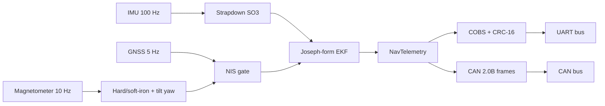

# stm32-navcore

Deterministic `no_std`, zero-alloc Rust navigation core for STM32 Cortex-M4F targets (`thumbv7em-none-eabihf`).

It combines strapdown attitude, a Joseph-form IMU/GNSS Extended Kalman Filter, and a COBS/CRC-16/CAN telemetry codec.

The only dependency is `libm`. Library code never touches `std` or the heap.

## Modules

| Module | Purpose |
| --- | --- |
| `math` | Fixed-size `Mat<R, C>`, SO(3) `Quaternion`, tilt-compensated heading |
| `ekf` | Joseph-form IMU/GNSS Extended Kalman Filter with NIS gating |
| `protocol` | COBS framing, CRC-16-CCITT, CAN 2.0B and UART telemetry frames |

## Architecture

## Mathematical summary

**Strapdown attitude.** The quaternion `q` is advanced with the exact finite-angle rotation `dq = [cos(|w|dt/2), sin(|w|dt/2) * w/|w|]` and renormalized.

**Hard/soft-iron heading.** The calibrated field is `b_cal = S * (b_raw - h)`, with soft-iron matrix `S` and hard-iron offset `h`.

The field is rotated into the horizontal plane with roll and pitch, and yaw is `atan2(-by_h, bx_h)`.
