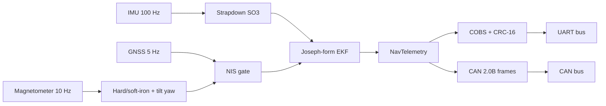

# stm32-navcore

Deterministic `no_std`, zero-alloc Rust navigation core for STM32 Cortex-M4F targets (`thumbv7em-none-eabihf`).

It combines strapdown attitude, a Joseph-form IMU/GNSS Extended Kalman Filter, and a COBS/CRC-16/CAN telemetry codec.

The only dependency is `libm`. Library code never touches `std` or the heap.

## Modules

| Module | Purpose |
| --- | --- |
| `math` | Fixed-size `Mat<R, C>`, SO(3) `Quaternion`, tilt-compensated heading |
| `ekf` | Joseph-form IMU/GNSS Extended Kalman Filter with NIS gating |
| `protocol` | COBS framing, CRC-16-CCITT, CAN 2.0B and UART telemetry frames |

## Architecture



## Mathematical summary

**Strapdown attitude.** The quaternion `q` is advanced with the exact finite-angle rotation `dq = [cos(|w|dt/2), sin(|w|dt/2) * w/|w|]` and renormalized.

**Hard/soft-iron heading.** The calibrated field is `b_cal = S * (b_raw - h)`, with soft-iron matrix `S` and hard-iron offset `h`.

The field is rotated into the horizontal plane with roll and pitch, and yaw is `atan2(-by_h, bx_h)`.

**Joseph-form update.** Covariance is updated as `P = (I - K H) P (I - K H)^T + K R K^T` and then symmetrized, which keeps `P` positive semi-definite under rounding.

Measurements are accepted only if `NIS = y^T S^-1 y` is below the chi-square gate.

**Framing.** Telemetry is protected by CRC-16-CCITT (`poly 0x1021`, `init 0xFFFF`, check value `0x29B1` for `123456789`).

UART frames are COBS-encoded and terminated by `0x00`. CAN frames use 29-bit extended identifiers and at most 8 data bytes.

## HIL trajectory results

`tests/hil_trajectory.rs` runs a deterministic 60 s figure-eight (100 Hz IMU, 10 Hz magnetometer, 5 Hz GNSS) with a 5 s GNSS outage.

Every epoch is round-tripped through the COBS/CRC-16 UART and CAN 2.0B codecs.

| Metric | Measured | Test bound |
| --- | --- | --- |
| Horizontal position RMSE under GNSS lock | 0.060 m | < 1.0 m |
| Max position drift during 5 s outage | 0.094 m | < 5.0 m |
| Position error after reacquisition | 0.010 m | < 1.0 m |
| Gyro Z bias error at end of flight | 0.000038 rad/s | < 0.005 rad/s |

Measured on a host build with a fixed `XorShift64` seed, so the values are reproducible.

## Build and verification

```sh
cargo fmt --all -- --check
cargo clippy --all-targets -- -D warnings
cargo test --all-targets
rustup target add thumbv7em-none-eabihf
cargo check --target thumbv7em-none-eabihf
```

## Memory footprint

Sizes measured with `core::mem::size_of` (all fields are `f32`, 4-byte aligned, so the layout matches `thumbv7em-none-eabihf`).

| Type | Bytes |
| --- | --- |
| `NavEkf` | 300 |
| `Quaternion` | 16 |
| `Mat<3, 3>` | 36 |

A unit test asserts `size_of::<NavEkf>() < 2048`.

## License

MIT. See `LICENSE`.
